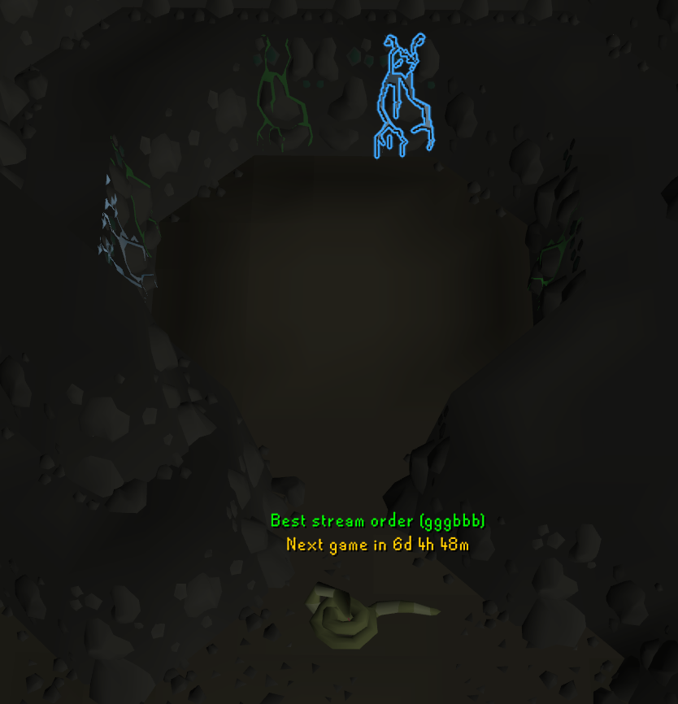
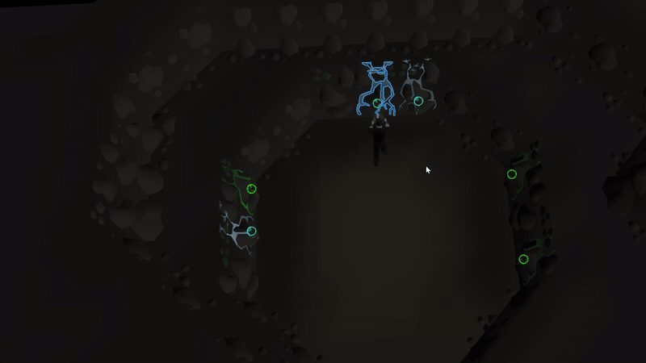

# Tears of Guthix Optimizer

Highlights the best weeping wall in Tears of Guthix, including when to wait at your wall for a blue
stream to land, using the stream mechanics described on the OSRS Wiki. Above Juna, it also shows
whether the world has the best stream order, when to enter, and when you can play next.

## Features

- **Sidebar.** Click the blue stream icon to see your next reset, when its data was last updated,
  and the skill and XP predicted for your next bowl. Times are local. Hover over the reset date
  for UTC. Open **Quest List → Tears of Guthix** to refresh the data, even if the date is unchanged.
- **Bowl reward and history.** Before a run, the estimate uses the tears from your last recorded
  bowl and the rate for your current lowest eligible skill. If only the last XP award is available,
  it uses that amount as a guide. During a run the estimate follows your live bowl. Use the
  history dropdown to see the date, skill and XP of earlier runs recorded on this character.
  Older installations that saved only a tear count can use that count for the estimate. Recording
  the actual XP and skill starts with runs seen by this version.
- **Best wall.** Outlines the stream to collect from, worked out from where every stream is and when
  each one moves next.
- **Wait.** When staying put is better, your wall is outlined in yellow with a countdown of the ticks
  left before it's time to move.
- **Green streams.** A left click on a wall with a green stream walks instead of collecting. Collect-from
  stays in the right-click menu.
- **Post-game summary.** After a game, chat shows your tears next to what following the plugin perfectly
  would have collected and the most possible in hindsight, then any tears lost to a late entry, late
  clicks, clicks off the highlight, extra walking or green streams. Each is worked out by replaying
  your game on the streams it recorded.
- **Preview.** Outside the wall room, the walls show the plugin's advice on the live streams, so you can
  see how it works before playing.
- **Stream order.** Shows above Juna whether the world moves its streams in the best order: green,
  green, green, blue, blue, blue.
- **When to enter.** Tell Juna a story and stop on her last line. A countdown shows when to continue
  so your game starts at a good point in the stream cycle.
- **Next game.** Shows above Juna how long until you can play again, and optionally the quest point or
  experience still needed.
- **Weekly reminder** (off by default). Turn this on in the Juna settings for a RuneLite notification
  when you can play again. Enter `::togstatus` anywhere to check your character's weekly wait and XP
  or quest point progress.
- **Reset notification on login** (off by default). Under **Juna**, choose **Once per day** for
  the first login per character each UTC day, or **Every login**. The notification includes your
  reset time and remaining requirements. With no saved reset, it prompts you to open the journal.
  World hops keep the same login. To see desktop alerts while the game has focus, enable
  **Send notifications when focused** in RuneLite's notification settings.
- **XP reward.** Shows the skill Juna would train and the XP per tear. After a tracked run it estimates
  the reward for matching your previous bowl if the final count was clear. During a run it uses the
  tears currently in your bowl.
  Enter `::togxp` to check from anywhere, or `::togxp 150` for an estimate at 150 tears.
- **World suggestions** (off by default). Suggests nearby worlds with the best stream order. A hotkey
  (Ctrl+Shift+Up) or Juna's Hop-to option hops to the first one, and Hop-to can be made her left-click.
- **Expected tears** (off by default). Shows how many tears the highlighted wall is expected to give
  over the next 40 ticks.

## How it works

The OSRS Wiki describes the minigame: nine walls, three blue and three green streams, each staying for
16 ticks before moving to a random empty wall, one after another in an order fixed for each world.
The plugin tracks every stream, plays out possible futures from the current moment, and highlights
the choice that collects the most tears on average. Walking and start-up times were measured in game.

It works alongside RuneLite's built-in Tears of Guthix plugin, so its stream timers can stay on.

## Tracking a previous visit

The plugin records a visit when your character drinks the bowl. If you played on mobile or installed
the plugin after your last run, open **Quest List → Tears of Guthix** on a regular members' world.
The plugin reads the journal and updates this character's weekly reset and XP or quest point progress.
You'll see a chat confirmation even if the sidebar is closed. You can open the journal again after
another mobile visit. Journal sync works with online world lookup and notifications turned off.

You can also enter the remaining days and XP manually with `::togstatus sync 3 25000`, using zero
for a requirement you've met. If you only know the UTC date of your visit, use
`::togstatus last YYYY-MM-DD`.

XP previews apply to ordinary OSRS worlds and include skill unlocks, the hard Lumbridge & Draynor
Diary bonus and the 200 million XP cap. RuneLite reports whole skill XP, so a fractional tie can
affect which skill is predicted.

## Online world list

**Look up worlds online** is off by default. When turned on, it reads the stream orders that ToG
Crowdsourcing users have reported, from `togcrowdsourcing.com`, a third-party site that will see your
IP address. Nothing is ever sent to it, and no account information is shared. The list is only read
while you're at Juna.

To suggest nearby worlds, the plugin also times a connection to each candidate world's game server,
once per login. Only Jagex's servers are contacted for this.

## Reporting a problem

Turn on **Debug logging**, reproduce the problem, and include the lines containing `togoptimizer` from
your client log (`%USERPROFILE%\.runelite\logs\client.log` on Windows, `~/.runelite/logs/client.log`
on macOS and Linux). A short screen recording helps too.

## License

BSD 2-Clause. See [LICENSE](LICENSE).
